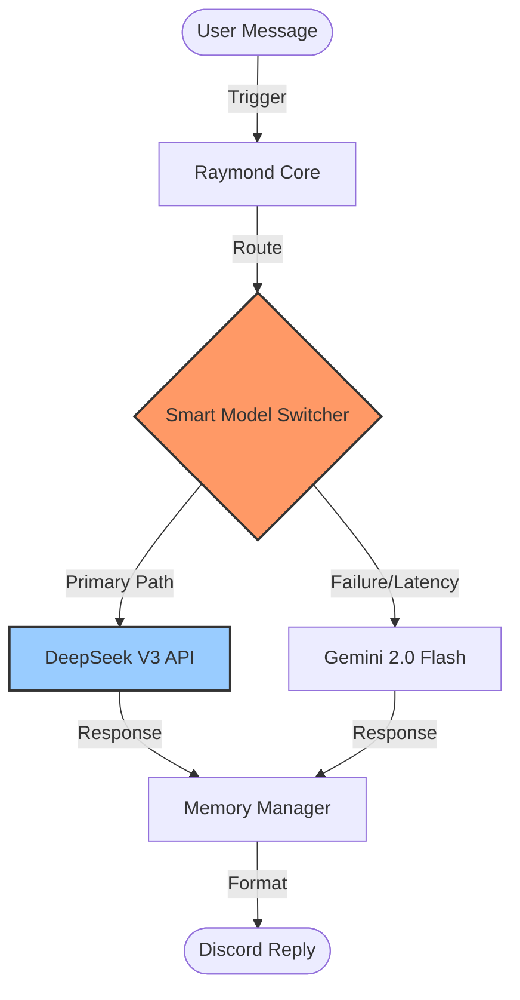
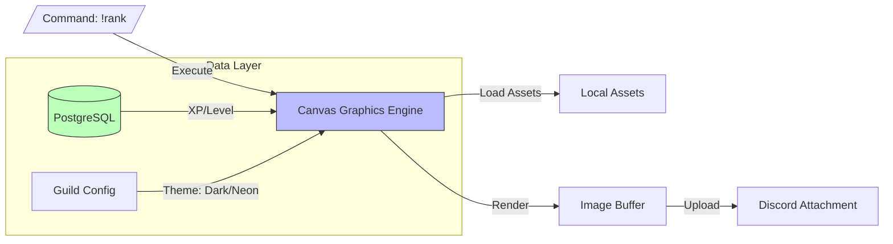

> Historical project notes. AI functionality described below was removed in October 2026. See README.md and DEVELOPMENT.md for the current implementation.

# 🌌 Raymond v2 - Project Overlord: Architecture & Progress Report
> **Last Updated:** February 2026 (v2.0.9 Enterprise)

## 1. The "Project Overlord" Evolution
Raymond v2 represents a paradigm shift from the legacy "Parallel Ultra Bot". Moving beyond simple administration commands, v2 acts as a **Neural & Visual Operating System** for Discord.

### Core Pillars
1.  **Neural Intelligence:** Dual-model AI (DeepSeek/Gemini) with context awareness.
2.  **Visual Interaction:** Dynamic image generation for Leaderboards, Welcomers, and Ranks.
3.  **Autonomous Control:** No-code `!levelsetup` dashboards and self-healing configurations.

---

## 2. Updated Architecture Diagrams (v2.0.9)

### 🧠 The "Smart Switcher" AI Core
How the bot maintains high availability by intelligently routing prompts between DeepSeek V3 and Gemini 2.0.



### 🎨 The Visual Graphics Pipeline
How the new Canvas Engine renders 4K assets like Rank Cards and Leaderboards on the fly, replacing old text lists.



---

## 3. Key Feature Additions (Last Month)

### 🤖 Neural Core Integration
*   **Smart Fallback:** If DeepSeek is overloaded, Gemini takes over instantly.
*   **Persona Engine:** Enforced "Helpful Mastermind" personality via system prompts.

### 🖼️ Visual System Overhaul
*   **Image Leaderboards:** Replaced strictly text-based lists with generated podium images.
*   **Dynamic Themes:** Added "Pitch Black" and "Neon" themes adapt to server preference.

### 🎛️ The Application Dashboard
*   **No-Code Config:** `!levelsetup` now opens a GUI with Buttons and Dropdowns.
*   **Live Previews:** Admins can preview Level Up messages before saving.

---
👇 **LEGACY DOCUMENTATION (Parallel Ultra Bot v1.0)** 👇
---

# Parallel Ultra Bot – Project Architecture & Progress Summary

## Overview
Parallel Ultra Bot is a scalable, multi-guild Discord bot built with Node.js, discord.js, and PostgreSQL. It features a modular command/event system, persistent per-guild configuration, and a centralized, fully customizable embed system for consistent branding and UX.

---

## Project Structure
```
Parallel Ultra Bot/
├── .env, package.json, CHANGELOG.md
├── src/
│   ├── commands/           # Modular command files (ping, setembedcolor, etc.)
│   ├── database/           # PostgreSQL config and helpers (guildConfig.js)
│   ├── events/             # Event handlers (messageCreate.js, ready.js)
│   ├── handlers/           # Command/event loaders, hot-reload, sendEmbed
│   ├── utils/              # Utilities (embed.js, logger.js, changelog.js)
│   └── index.js            # Main entry point
└── logs/, node_modules/, ...
```

---

## Features Implemented

### 2025-06-17
- **Instant Private Temp Voice Channels:** A powerful and flexible system for creating on-demand, private voice channels.
  - **Dynamic Creation:** Automatically creates a new voice channel when a user joins a designated "creator" channel.
  - **Multi-Config Support:** Servers can set up multiple, independent temporary channel configurations (e.g., for general use, private support, events), each with its own creator channel and support role.
  - **Instant Deletion:** Temporary channels are deleted the moment the last user leaves, ensuring no clutter.
  - **Private by Default:** New channels are created with permissions that make them visible only to the channel creator and an optional, configurable support role.
  - **Clones Creator Channel:** The new channel automatically clones the name (appending the user's name), bitrate, and user limit from the creator channel, ensuring consistent quality and naming.
  - **Commands:**
    - `=tempvoice setup [type] <#channel|channelID> [@role]` - Configures a new temporary voice system.
    - `=tempvoice disable [type]` - Turns off a configuration.
    - `=tempvoice list` - Displays all active configurations for the server.
  - **Database Integration:** All configurations and active channels are stored persistently in PostgreSQL.

### 2025-06-03
- **Anti-Nuke Protection System:** A comprehensive security system to protect servers from mass destructive actions:
  - **Protected Actions:**
    - Channel creation/deletion
    - Role creation/deletion
    - Member bans/kicks
    - Emoji deletion
    - Webhook creation
  - **Configurable Thresholds:** Set custom limits for each action type
  - **Automatic Protection:** Takes immediate action when thresholds are exceeded
  - **Admin Notifications:** Alerts server admins when protection is triggered
  - **Whitelist System:** Exempt trusted users from protection
  - **Protected Roles:** Prevent modification of important roles
  - **Interactive Dashboard:** Easy configuration through a Discord interface
  - **Premium Feature:** Available only to Godmode tier subscribers

### 2025-06-03
- **Permission Management Commands:** New moderation commands for channel permission management:
  - `!add @user [permissions...]` - Add permissions to a user/role in a channel
    - `!add @user all` - Grant all available permissions
    - `!add @user send attach` - Grant specific permissions
    - Supports both user and role mentions
  - `!deny @user [permissions...]` - Remove permissions from a user/role in a channel
    - `!deny @user all` - Remove all permissions
    - `!deny @user send` - Remove specific permissions
    - Supports both user and role mentions
  - **Available Permissions:**
    - Text: `view`, `send`, `attach`, `react`, `history`, `external_emojis`, `external_stickers`
    - Voice: `connect`, `speak`, `stream`, `use_activities`, `use_soundboard`, `use_external_sounds`

### 2025-06-02
- **Prefixless Command Aliases:** Commands can now be used without a prefix using their aliases (e.g., `u @user` for userinfo)
- **Information Commands:** New utility commands with detailed information:
  - `roleinfo` - Shows role information, permissions, and members
  - `channelinfo` - Displays channel details and permission settings

### 2025-05-31
- **Dynamic Command/Event Loading:** Modular system with hot-reload for development.
- **Per-Guild Prefix Management:** Persistent in PostgreSQL, admin command to update.
- **Centralized Embed System:** Consistent, branded embeds for all outgoing messages.

### 2025-06-01
- **Centralized Embed Sending Utility:** Handles all message contexts (message, interaction, DM, etc.).
- **Admin Embed Customization Commands:** `setembedcolor`, `setembedfooter`, `setembedicon` for per-guild branding (color, footer, icon/thumbnail).
- **Error/System Embed Helpers:** Standardized error/success/info embeds for UX consistency.
- **Database Persistence for Embed Settings:** All embed customization is now stored per-guild in PostgreSQL.
- **Comprehensive Logging & Changelog:** All significant actions/events/errors are logged and tracked.
- **Environment Variables:** For all secrets and config.

---

## Database Model
- **Table:** `guild_configs`
    - `guild_id` (PK)
    - `prefix` (string)
    - `settings` (JSONB)
        - `embed_settings` (object)
            - `color` (int)
            - `footer` (object: { text, iconURL })
            - `thumbnail` (string)
---

## Poject Folder Structure
```
Parallel Ultra Bot/
├── src/                    # Source code
├── logs/                   # Log files
├── .env                    # Environment variables
├── package.json            # Project dependencies
├── package-lock.json       # Lock file
├── PROJECT_SUMMARY.md      # Project documentation
├── CHANGELOG.md           # Version history
└── logs/                  # Log files
    ├── error.log
    └── combined.log
```
## Source Code (/src)

src/
├── commands/              # Command modules
│   ├── OwnerOnly/         # Owner-only commands
│   │   ├── godmode/       # High-privilege commands
│   │   │   ├── antiNuke.js
│   │   │   └── branding.js
│   │   └── stellar/       # Premium commands
│   │       ├── modmail.js
│   │       ├── moveall.js
│   │       └── rolemenu.js
│   ├── moderation/        # Moderation commands
│   │   ├── ban.js
│   │   ├── kick.js
│   │   ├── warn.js
│   │   └── ...
│   └── utility/           # Utility commands
│         ├── userinfo.js
│         ├── channelinfo.js
│         └── ...
│
├── database/              # Database models and queries
│   ├── guildConfig.js     # Guild settings
│   ├── warns.js           # Warning system
│   ├── jailSetting.js     # Jail system
│   └── autoRole.js        # Auto-role system
│
├── events/                # Event handlers
│   ├── guild/             # Guild events
│   ├── message/           # Message events
│   └── ready.js           # Bot ready event
│
├── handlers/              # Core handlers
│   ├── commandHandler.js  # Command processor
│   ├── eventHandler.js    # Event processor
│   └── slashCommandHandler.js # Slash commands
│
├── utils/                 # Utility functions
│   ├── logger.js          # Logging system
│   └── embed.js           # Embed builder
│
└── index.js               # Main application entry


## Architectural Diagram (Textual)
```
[Discord API] <-> [discord.js Client (index.js)]
                      |
    ┌────────────────┬───────────────────┬────────────────────┐
    |                |                   |                    |
[Commands/]     [Events/]       [Interactions/]    [Handlers/]
    |                |                   |                    |
    ├─ OwnerOnly/   ├─ guild/           ├─ Slash Commands   ├─ command.js
    │  ├─ godmode/  ├─ message/         ├─ Buttons          ├─ event.js
    │  └─ stellar/  └─ ready.js         ├─ Select Menus     └─ interaction.js
    ├─ Moderation/                      └─ Modals           [Audio/]
    ├─ Utility/
    └─ Automod/
         └─ antiNuke/


    [Utils/]                           [Database/]                [Systems/]
    ├─ logger.js                       ├─ guildConfig.js          ├─ Anti-Nuke
    ├─ embed.js                        ├─ warns.js                ├─ Premium
    ├─ errorHandler.js                 ├─ jailSetting.js          └─ Audio
    └─ permissions.js                  └─ autoRole.js

[External Services]
├─ PostgreSQL Database
├─ Discord Webhooks
└─ Premium API (if applicable)
```

## Architectural Diagram (Visual)

```
┌────────────────────────────┐
│        Discord API         │
└─────────────┬──────────────┘
              │
     [discord.js Client (index.js)]
              │
  ┌───────────┼─────────────────────────────────────────────────────────────────────┐
  │           │                                                                     │
  ▼           ▼                                                                     ▼
[Events/]  [Commands/]                                                      [Interactions/]
  │           │                                                                     │
  │           ├──────────────────────────────────────────────────────────────────────┘
  ▼           ▼
[Client/]  [OwnerOnly/]   [Moderation/]   [AFK/]   [Announcement/]   [Automod/]
  │         ├─ godmode/   ├─ ban.js       │         │                 ├─ antiNuke/
  │         │  ├ antiNuke.js ├─ kick.js   │         │                 │  ├ actions.js
  │         │  └ branding.js ├─ warn.js   │         │                 │  ├ configManager.js
  │         │               └─ ...        │         │                 │  ├ detector.js
  │         ├─ stellar/    [Utility/]     │         │                 │  └ logger.js
  │         │  ├ modmail.js ├─ help.js    │         │                 └─ autoban.js
  │         │  ├ moveall.js ├─ ping.js    │         │
  │         │  └ rolemenu.js└─ ...        │         │
  │         │                            │         │
  │         │                            │         │
  ▼         ▼                            ▼         ▼
┌───────────────────────────────────────────────────────────────────────────────────┐
│                             Core Systems                                          │
│  ┌───────────────────────┐    ┌────────────────────────┐    ┌──────────────────┐  │
│  │     Database Layer    │    │     Utils & Helpers    │    │     Handlers     │  │
│  │  ├ guildConfig.js     │    │  ├ logger.js           │    │  ├ command.js    │  │
│  │  ├ warns.js           │    │  ├ embed.js            │    │  ├ event.js      │  │
│  │  ├ jailSetting.js     │    │  ├ errorHandler.js     │    │  ├ interaction.js│  │
│  │  └ autoRole.js        │    │  └ permissions.js      │    │  └ audio/        │  │
│  └───────────┬───────────┘    └───────────┬────────────┘    └────────┬─────────┘  │
│              │                             │                          │           │
│  ┌───────────▼─────────────────────────────▼────────────────────────┐             │
│  │                        Premium System                            │ │            │
│  │  ┌───────────────────────┐    ┌────────────────────────┐       │ │ │            │
│  │  │     Tiers:           │    │     Features:           │         │ │            │
│  │  │  ├ Stellar Matrix    │    │  ├ Modmail              │         │ │            │
│  │  │  ├ Cosmic Nexus      │───▶│  ├ Advanced Moderation │─────── ─┘  │             │
│  │  │  └ Galactic Core     │    │  └ Custom Branding      │           │            │
│  │  └───────────────────────┘    └────────────────────────┘           │            │
│  │                                                                    │            │
│  └───────────────────────────────────────────────────────────────────┘            │
│                                                                                   │
└───────────────────────────────────────────────────────────────────────────────────┘
                             │
                             ▼
               ┌─────────────────────────────┐
               │      External Services      │
               │  ┌───────────────────────┐  │
               │  │   PostgreSQL DB       │  │
               │  ├───────────────────────┤  │
               │  │   Discord Webhooks    │  │
               │  ├───────────────────────┤  │
               │  │   Premium API         │  │
               │  └───────────────────────┘  │
               └─────────────────────────────┘
```

### Key Components:

1.  **`src/index.js`**: Main application entry point, initializes the Discord client, loads handlers, and connects to the database.

2.  **`src/commands/`**: Houses all bot command logic, categorized by functionality.
    *   **`OwnerOnly/`**: Commands restricted to the bot owner(s).
        *   `godmode/`: High-privilege commands (e.g., `antiNuke.js`, `branding.js`).
        *   `stellar/`: Premium feature commands (e.g., `modmail.js`, `moveall.js`, `rolemenu.js`).
        *   Direct files: `massdm.js`, `nukeChannels.js`, `premium.js`, `shutdown.js`.
    *   **`afk/`**: AFK status management commands.
    *   **`announcement/`**: Commands for making server announcements.
    *   **`automod/`**: Automated moderation features.
        *   `antiNuke/`: Core anti-nuke system logic (e.g., `actions.js`, `configManager.js`, `detector.js`, `logger.js`).
        *   `autoban.js`, `autospam.js`.
    *   **`autosetup/`**: Commands for automated bot setup in a guild.
    *   **`bot/`**: General bot-related commands (e.g., info, stats).
    *   **`moderation/`**: Standard moderation tools.
        *   Examples: `add.js` (permissions), `ban.js`, `clear.js`, `delwarn.js`, `deny.js` (permissions), `jail.js`, `jailsettings.js`, `kick.js`, `lock.js`, `move.js` (members), `mute.js`, `nickname.js`, `role.js`, `setautorole.js`, `setjailrole.js`, `setjailvoice.js`, `slowmode.js`, `unban.js`, `unjail.js`, `unlock.js`, `unmute.js`, `verify.js`, `warn.js`, `warns.js`.
    *   **`reactionroles/`**: Commands for setting up reaction roles.
    *   **`setup/`**: Guild-specific setup commands.
    *   **`tickets/`**: Ticket system commands.
    *   **`utility/`**: General utility commands (e.g., `help.js`, `ping.js`, `userinfo.js`, `serverinfo.js`).
    *   **`voice/`**: Voice channel related commands (e.g., voice channel management, music if not separate).

3.  **`src/database/`**: Manages database interactions and schemas using a PostgreSQL database. A connection pool (`pg.Pool`) is established using the `DATABASE_URL` environment variable. Each module typically includes an `ensureTable` or `ensureTables` function, executed at startup or before database operations, to create the necessary tables if they don't already exist. This ensures the database schema is correctly initialized.

    *   **`guildConfig.js`**: Handles guild-specific configurations.
        *   **Table:** `guild_configs`
            *   `guild_id` (VARCHAR, PRIMARY KEY): The Discord guild ID.
            *   `prefix` (VARCHAR, default: `!`): The custom command prefix for the guild.
            *   `settings` (JSONB, default: `{}`): Stores various guild-specific settings, including embed configurations (e.g., color, footer, thumbnail) under an `embed_settings` key.
            *   `created_at` (TIMESTAMP, default: NOW()): Timestamp of creation.
            *   `updated_at` (TIMESTAMP, default: NOW()): Timestamp of the last update.
        *   **Key Functions:**
            *   `ensureTable()`: Creates the `guild_configs` table if it doesn't exist.
            *   `getGuildConfig(guild_id)`: Retrieves the full configuration for a specific guild.
            *   `setGuildConfig(guild_id, config)`: Inserts a new guild configuration or updates an existing one (prefix and settings).
            *   `setGuildPrefix(guild_id, prefix)`: Updates only the command prefix for a guild.
            *   `setGuildEmbedSetting(guild_id, key, value)`: Sets or updates a specific embed setting (e.g., `color`, `footer.text`, `thumbnail`) within the `settings.embed_settings` JSONB field. Handles merging for object values like `footer`.

    *   **`warns.js`**: Manages user warnings within guilds.
        *   **Table:** `user_warnings`
            *   `id` (SERIAL, PRIMARY KEY): Unique identifier for the warning.
            *   `guild_id` (TEXT): The Discord guild ID where the warning was issued.
            *   `user_id` (TEXT): The Discord user ID of the warned user.
            *   `moderator_id` (TEXT): The Discord user ID of the moderator who issued the warning.
            *   `reason` (TEXT): The reason for the warning.
            *   `timestamp` (TIMESTAMP, default: CURRENT_TIMESTAMP): When the warning was issued.
        *   **Key Functions:**
            *   `ensureWarnsTable()`: Creates the `user_warnings` table.
            *   `addWarning(guildId, userId, moderatorId, reason)`: Adds a new warning to the database.
            *   `countWarnings(guildId, userId)`: Counts the total number of warnings for a user in a guild.
            *   `getWarnings(guildId, userId)`: Retrieves all warnings for a user in a guild.
            *   `deleteWarning(warningId)`: Deletes a specific warning by its unique `id`.
            *   `deleteAllWarnings(guildId, userId)`: Deletes all warnings for a specific user in a guild.
            *   `getWarningByIdGuildUser(warningId, guildId, userId)`: Retrieves a specific warning by its ID, ensuring it belongs to the specified guild and user.

    *   **`jailSetting.js`**: Manages the jail system settings and tracks jailed users.
        *   **Table 1:** `jail_settings`
            *   `guild_id` (TEXT, PRIMARY KEY): The Discord guild ID.
            *   `jail_role_id` (TEXT): The ID of the role assigned to jailed users.
            *   `jail_voice_channel_id` (TEXT): The ID of the voice channel users are moved to when jailed (if applicable).
        *   **Table 2:** `jailed_users`
            *   `id` (SERIAL, PRIMARY KEY): Unique identifier for the jailed user record.
            *   `guild_id` (TEXT): The Discord guild ID.
            *   `user_id` (TEXT): The Discord user ID of the jailed user.
            *   `saved_role_ids` (TEXT): A JSON string array of the user's original role IDs, stored to be restored upon unjailing.
            *   `jailed_at` (TIMESTAMP, default: CURRENT_TIMESTAMP): When the user was jailed.
            *   `UNIQUE(guild_id, user_id)`: Ensures a user can only be jailed once per guild at a time.
        *   **Key Functions:**
            *   `ensureTables()`: Creates both `jail_settings` and `jailed_users` tables.
            *   `getGuildSettings(guildId)`: Retrieves the jail role and voice channel ID for a guild.
            *   `setJailRole(guildId, jailRoleId)`: Sets or updates the jail role for a guild.
            *   `setJailVoiceChannel(guildId, channelId)`: Sets or updates the jail voice channel for a guild.
            *   `saveJailedUser(guildId, userId, roleIds)`: Records a user as jailed, saving their current roles (as a JSON string).
            *   `getJailedUser(guildId, userId)`: Retrieves a jailed user's data, parsing `saved_role_ids` back into an array.
            *   `removeJailedUser(guildId, userId)`: Removes a user's record from the `jailed_users` table (typically upon unjailing).

    *   **`autoRole.js`**: Manages the auto-role assignment for new members in a guild.
        *   **Table:** `guild_auto_roles`
            *   `guild_id` (TEXT, PRIMARY KEY): The Discord guild ID.
            *   `auto_role_id` (TEXT): The ID of the role to be automatically assigned to new members.
        *   **Key Functions:**
            *   `ensureTable()`: Creates the `guild_auto_roles` table.
            *   `getAutoRole(guildId)`: Retrieves the auto-role ID for a specific guild.
            *   `setAutoRole(guildId, roleId)`: Sets or updates the auto-role ID for a guild.

4.  **`src/events/`**: This directory stores individual JavaScript files, each dedicated to handling a specific Discord client event. The `eventHandler.js` (detailed in Section 5 under Handlers) loads `.js` files directly from this root directory. Each event file is expected to export an object with at least a `name` (the Discord.js event name, e.g., `Events.ClientReady`, `Events.MessageCreate`) and an `execute` function which contains the logic for that event. An optional `once: true` property can be exported if the event should only be handled once upon its first occurrence.

    *   **Key Event Files (loaded from the root of `src/events/`):**
        *   `ready.js`: Handles the `ClientReady` (or equivalent) event, crucial for tasks performed once the bot successfully connects to Discord (e.g., logging ready status, setting bot activity/presence, initializing systems like the premium table check).
        *   `interactionCreate.js`: Handles all incoming interactions, including slash commands, button clicks, select menu selections, and modal submissions. This file is pivotal for routing these interactions to the appropriate command execution logic (from `client.slashCommands`) or component-specific handlers.
        *   `messageCreate.js`: Handles the `MessageCreate` event, triggered whenever a new message is sent in a channel the bot can read. This is the primary entry point for processing traditional prefix-based commands and can also include logic for message-based auto-moderation or other message content analysis.
        *   `guildMemberAdd.js`: Handles the `GuildMemberAdd` event, fired when a new user joins a guild. Commonly used for sending welcome messages, assigning auto-roles (if configured via `autoRole.js`), or logging new members.

    *   **Subdirectories (e.g., `channel/`, `client/`, `emoji/`, `event/`, `giveaway/`, `guild/`, `invite/`, `message/`, `music/`, `role/`, `stats/`, `sticker/`, `thread/`, `voice/`, `warn/`):**
        *   These subdirectories are present within `src/events/` and likely serve an organizational purpose, intended to group event files by their category (e.g., all channel-related events in `channel/`).
        *   It's important to note that the current `eventHandler.js` loads event files only from the root of the `src/events/` directory. For event files within these subdirectories to be active, they would either need to be moved to the root `src/events/` directory, or the `eventHandler.js` would require modification to recursively scan these subdirectories.

5.  **`src/handlers/`**: Contains the core logic for loading, processing, and managing various types of bot inputs and events. It ensures that commands, Discord events, and interactions are correctly registered and executed.

    *   **`commandHandler.js`**: Responsible for loading and managing traditional prefix-based commands.
        *   **Loading:** Recursively scans the `src/commands/` directory for `.js` files.
        *   Each valid command file (expected to export an object with `name` and `execute` properties) is loaded and stored in a `Map` on the `client` object (e.g., `client.commands`).
        *   Logs successful loads and errors during loading using the `logger` utility.
        *   **Hot Reloading:** Implements a hot-reloading feature using `chokidar` to monitor the commands directory for changes (add, change, unlink). When a file is modified or added, it reloads the command. When a file is deleted, it unloads the command. This allows for dynamic updates to commands without restarting the bot.
        *   **Key Functions:** `loadCommands(client, commandsPath)`, `setupCommandHotReload(client, commandsPath)`, `reloadCommand(client, file)`, `unloadCommand(client, file)`.

    *   **`eventHandler.js`**: Manages the loading and registration of Discord client event listeners.
        *   **Loading:** Scans the `src/events/` directory for `.js` files.
        *   Each valid event file (expected to export an object with `name`, `execute` function, and optionally an `once` boolean) is registered with the Discord client using `client.on()` or `client.once()`.
        *   The `execute` function of an event is called with the event arguments and the `client` instance.
        *   Logs successful loads and errors.
        *   **Hot Reloading:** Similar to `commandHandler.js`, uses `chokidar` to monitor the events directory. When an event file changes, it removes all existing listeners for that event and re-registers the new version. This allows for dynamic updates to event handling logic.
        *   **Key Functions:** `loadEvents(client, eventsPath)`, `setupEventHotReload(client, eventsPath)`, `reloadEvent(client, file)`, `unloadEvent(client, file)`.

    *   **`slashCommandHandler.js`**: Handles the loading and registration of Discord slash commands (application commands).
        *   **Loading:** Recursively scans a specified directory (e.g., `src/interactions/Command/`) for `.js` files containing slash command definitions.
        *   Each valid command file (expected to export `data` - a `SlashCommandBuilder` instance or similar - and an `execute` function) is loaded into a `Collection` on the `client` object (e.g., `client.slashCommands`).
        *   Includes checks for valid command structure and duplicate command names.
        *   **Registration:** Provides a function to register the loaded slash commands with Discord's API using `discord.js` REST methods (`Routes.applicationGuildCommands` for specific guilds or `Routes.applicationCommands` for global registration).
        *   **Key Functions:** `loadSlashCommands(client, commandsPath)`, `registerSlashCommands(client, guildId)`. (Note: The actual execution of slash commands upon receiving an `interactionCreate` event is typically handled in the main bot file or a dedicated interaction handler that uses `client.slashCommands`).

    *   **`functions/` Subdirectory**: Contains utility functions that might be used by handlers or other parts of the bot.
        *   **`botProtection.js`**: Exports `protectBotTarget(targetUserId, clientUserId, messageAuthorId, ownerId)`. This function checks if a command or action is targeting the bot itself (`clientUserId`). If so, it allows the action only if the `messageAuthorId` is the `ownerId`. This prevents the bot from performing actions on itself unintentionally or maliciously by non-owners.
        *   **`sendEmbed.js`**: Exports `sendEmbed(context, options, sendOptions)`. This utility facilitates sending standardized embeds. It uses `createEmbed` (likely from `src/utils/embed.js`) which can fetch guild-specific embed configurations (e.g., color, footer) from the database via `guildConfig.js`. It intelligently determines how to send the reply based on the `context` (message, interaction, user, or channel object).

    *   Other potential handlers (based on common structures, though not explicitly detailed in provided file scan):
        *   `interactionHandler.js` (if separate from `slashCommandHandler.js`): Could be a more general handler for all `interactionCreate` events, routing them to appropriate handlers for slash commands, buttons, select menus, and modals.
        *   `componentHandler.js` or similar in `handlers/components/`: For managing interactions with message components (buttons, select menus).
        *   `modalSubmitHandler.js`: For handling modal submissions.

6.  **`src/interactions/`**: This directory is central to defining and managing modern Discord interactions, primarily focusing on slash commands as per the project's migration plan. The `slashCommandHandler.js` (see Section 5) is responsible for loading command definitions from this area.

    *   **`Command/` Subdirectory**: This is the primary location for individual slash command files. Each `.js` file typically exports a `data` object (created using `SlashCommandBuilder` or a similar constructor) defining the command's name, description, options, and permissions, and an `async execute(interaction)` function containing the command's logic.
        *   **`Setembedcolor.js`**: Allows administrators to set a custom hex color for embeds sent by the bot in the current server. It validates the color format, updates the setting in `guildConfig.js` via `setGuildEmbedSetting`, and uses the `sendEmbed` utility for confirmation.
        *   **`ping.js`**: A basic utility command that replies with "Pong!" and a confirmation message, demonstrating the bot's responsiveness to slash commands. Uses `sendEmbed`.
        *   **`setembedfooter.js`**: Enables administrators to define custom footer text for embeds in the server. It updates `guildConfig.js` and uses `sendEmbed`.
        *   **`setembedicon.js`**: Allows administrators to set a custom footer icon (and thumbnail) URL for embeds. It validates the URL, updates `guildConfig.js`, and uses `sendEmbed`.

    *   **`README.md`**: Contains a "Slash Command Migration Plan" (dated 2025-06-01). This document outlines the strategy for migrating traditional text-based commands to slash commands. Key aspects of the plan include:
        *   Standardizing slash command file placement in `src/interactions/Command/`.
        *   Utilizing `slashCommandHandler.js` for loading and registration.
        *   Refactoring existing commands (e.g., embed customization commands) into the slash command format.
        *   Mandating the use of the `sendEmbed` utility for all slash command responses to ensure consistency and per-guild customization.
        *   A phased rollout and testing approach.
        *   It also mentions a `ContectMenu` folder (likely a typo for `ContextMenu`) for context menu interactions. However, this folder was not found in the latest directory scan. If context menu commands are to be implemented, they would likely reside here.

    *   **Other Interaction Types (Buttons, Select Menus, Modals):**
        *   Currently, dedicated subdirectories for `Button/`, `SelectMenu/`, or `Modal/` handlers are not present within `src/interactions/`. 
        *   The handling of these component interactions is likely managed within the `interactionCreate.js` event listener (see Section 4), which would then dispatch them to specific logic, potentially defined within command files themselves or separate utility modules if the interactions are complex or reused.
        *   The migration plan in `README.md` focuses on slash commands, but future expansion could involve creating dedicated handlers or subdirectories here for other interaction components if needed.

7.  **`src/premium/`**: Manages the bot's premium features, tier system, and guild subscriptions. The logic is primarily contained within `premium.js` and interacts with the PostgreSQL database.
    *   **File:** `premium.js`
        *   **Database Table:** `premium_guilds`
            *   `guild_id` (VARCHAR(32), PRIMARY KEY): The Discord guild ID that has a premium subscription.
            *   `activated_at` (TIMESTAMP, DEFAULT NOW()): Timestamp when the premium subscription was activated or last renewed.
            *   `expires_at` (TIMESTAMP): Timestamp when the premium subscription expires. Can be NULL for lifetime or non-expiring plans.
            *   `plan_type` (VARCHAR(32), DEFAULT 'basic'): The type or tier of the premium plan (e.g., 'basic', 'stellar', 'godmode'). This column is added via an `ALTER TABLE` command if it doesn't exist, ensuring backward compatibility.
            *   `buyer_id` (VARCHAR(32)): The Discord user ID of the person who purchased or activated the premium subscription for the guild. This column is also added via `ALTER TABLE` if missing.
        *   **Key Functions & Logic:**
            *   `ensurePremiumTable()`: Creates the `premium_guilds` table if it doesn't exist and ensures the `plan_type` and `buyer_id` columns are present by altering the table if necessary. This is typically called by the `ready()` function at bot startup.
            *   `ready()`: A function designed to be called at bot startup to initialize the premium system, primarily by calling `ensurePremiumTable()`.
            *   `isPremiumGuild(guildId)`: Checks if a given guild ID exists in the `premium_guilds` table, returning `true` if it's a premium guild, `false` otherwise.
            *   `addPremiumGuild(guildId)`: Adds a guild to the premium list with default values (e.g., basic plan, no specific expiry initially unless updated by another function). Uses `ON CONFLICT (guild_id) DO NOTHING` to avoid errors if the guild is already listed.
            *   `addPremiumGuildWithExpiry(guildId, days = 30, planType = 'basic', buyerId = null)`: Adds a guild to premium status or updates an existing premium subscription. It sets or updates the `activated_at` timestamp to now, calculates `expires_at` based on the `days` parameter (default 30), and records the `planType` (default 'basic') and `buyerId`. Uses `ON CONFLICT (guild_id) DO UPDATE` to handle existing entries, effectively allowing renewal or plan changes.
            *   `removePremiumGuild(guildId)`: Deletes a guild's entry from the `premium_guilds` table, revoking its premium status.
            *   `listPremiumGuilds()`: Returns a list of all `guild_id`s that have premium status.
            *   `listPremiumGuildsDetails()`: Returns a list of all premium guilds with their full details, including `guild_id`, `activated_at`, `expires_at`, `plan_type`, and `buyer_id`.
            *   `hasStellarOrHigher(guildId)`: Checks if a guild has a premium plan 'Stellar Matrix' (or similar, like 'stellar', 'godmode', 'godmode parallel') or higher. It queries the `plan_type` and performs a case-insensitive comparison.
            *   `hasGodmode(guildId)`: Checks if a guild has a 'Godmode' (or 'godmode parallel') plan type.
        *   **Integration:** This module is intended to be `require`'d in other parts of the codebase (e.g., within command files or feature handlers) to check for premium status before allowing access to certain features (feature gating).

8.  **`src/systems/`**: Houses complex, feature-specific system logic that often involves multiple event listeners, state management, and interaction with other modules like the database and utilities.

    *   **`antiNukeSystem.js`**: Implements the core Anti-Nuke protection logic for guilds.
        *   **Class:** `AntiNukeSystem`, instantiated with the Discord `client`.
        *   **Initialization:** Sets up event listeners for various Discord events (e.g., `Events.ChannelCreate`, with others planned for role creation/deletion, ban/kick storms, etc.).
        *   **Operation:** 
            *   Tracks potentially harmful activities (e.g., mass channel creation) per guild using an internal `Map` (`nukeProtection`).
            *   Fetches guild-specific Anti-Nuke settings (enabled status, action thresholds, whitelisted user IDs, and punitive actions) from the database using `getGuildConfig` (from `src/database/guildConfig.js`).
            *   If an activity count exceeds the configured threshold for a guild and the actor is not whitelisted, it triggers the `takeAction` method.
        *   **`takeAction(guild, user, reason, config)` Method:** Performs a series of configurable responses:
            *   `banOffender`: Bans the user who triggered the alert.
            *   `deleteSuspicious`: Deletes recently created content (e.g., channels created during a mass creation event).
            *   `lockdownServer`: Modifies the `@everyone` role permissions to restrict common actions, effectively putting the server in a lockdown state.
            *   `notifyAdmins`: Sends direct messages with an embed to all server administrators, detailing the event, the offender, and the actions taken.
        *   **Dependencies:** `discord.js`, `src/utils/logger.js`, `src/database/guildConfig.js`.

9.  **`src/utils/`**: Contains a collection of helper modules and utility functions that provide common, reusable functionality across various parts of the bot, promoting DRY (Don't Repeat Yourself) principles.

    *   **`logger.js`**: Implements a robust logging system using the `winston` library.
        *   **Transports:** Configured to log to files (`logs/error.log` for errors, `logs/combined.log` for all levels) and to the console (with colorization, in non-production environments).
        *   **Format:** Logs include timestamps, error stack traces, and a service identifier.
        *   **Changelog Integration:** Wraps `winston`'s `info`, `warn`, and `error` methods to automatically call `updateChangelog` (from `changelog.js`), ensuring significant log events are also recorded in the main project changelog.

    *   **`embed.js`**: Centralizes the creation of Discord message embeds, ensuring a consistent look and feel, and leveraging per-guild customization.
        *   **`getGuildEmbedConfig(guildId)`**: Fetches guild-specific embed settings (e.g., color, footer text, footer icon URL, thumbnail URL) from the database via `guildConfig.js`. Falls back to `DEFAULT_COLOR` and `DEFAULT_FOOTER` constants if no custom settings are found.
        *   **`createEmbed(guildId, options)`**: The primary function for generating `EmbedBuilder` instances, applying the fetched or default guild branding.
        *   **Helper Embeds:** Includes `createErrorEmbed` and `createSystemEmbed` for quickly generating standardized embeds for error messages and success/system notifications, often incorporating icons like ❌ and <:Done:1305644486453493801>.
        *   **Usage:** This module is a core component used by `sendEmbed.js` (in `src/handlers/functions/`) for all bot message responses.

    *   **`changelog.js`**: Provides a utility to maintain a project-wide `CHANGELOG.md` file.
        *   **`updateChangelog(type, description)`**: Appends a new entry to `CHANGELOG.md` located in the project's root directory. Each entry includes a timestamp, the type of event (e.g., 'INFO', 'ERROR', 'FEATURE'), and the provided description.
        *   **Date Management:** Automatically creates new date headers (e.g., `## YYYY-MM-DD`) in the changelog if one doesn't exist for the current day.

    *   **`gracefulShutdown.js`**: Manages the clean shutdown of the bot.
        *   **`gracefulShutdown(signal, client, dbClient)`**: Designed to be triggered by process signals (e.g., `SIGINT`, `SIGTERM`) or a shutdown command.
        *   **Actions:** Attempts to close the PostgreSQL database connection (if `dbClient` is provided and has an `end` method) and then destroys the Discord `client` instance to release resources before exiting the process.
        *   Uses `logger.js` to log shutdown progress and any errors.

    *   **`pendingFeatures.js`**: A utility for tracking feature requests and their status.
        *   Manages a `pending-features.json` file in the project root.
        *   **`addPendingFeature(description)`**: Adds a new feature request (description, date, status: 'pending') to the JSON file and logs this action to the `CHANGELOG.md`.
        *   **`approveFeature(index)`**: Updates the status of a feature at a specific index in the JSON file to 'approved', adds an `approvedDate`, and logs this to `CHANGELOG.md`.

    *   Note: `errorHandler.js` and `permissions.js`, which were part of the initial template, were not found in the current file structure. Error handling is likely distributed or managed by individual components and the logger, while permissions are checked within commands/interactions directly using Discord.js `PermissionFlagsBits` or custom logic.

10. **`src/config/`**: Intended for storing bot configuration files and static data.

    *   **`data/` Subdirectory**: This directory exists but is currently empty. It is reserved for storing static data files, default configuration templates, or other non-code assets the bot might need.
    *   **General Configuration**: No central bot configuration files (e.g., `config.json`, `settings.js`) were found directly within `src/config/`. Core configurations like the bot token, default prefix, and database URL are typically managed through environment variables (e.g., in a `.env` file at the project root) or are hardcoded/initialized in the main bot script (e.g., `index.js`). Guild-specific configurations are managed via the `guildConfig.js` database module.

11. **`src/commands/OwnerOnly/`**: This directory is dedicated to commands that are strictly for the bot owner's use. These commands typically involve global bot management, critical server operations, premium feature administration, and other high-privilege actions. They are essential for maintaining the bot, managing subscriptions, and performing sensitive tasks that should not be accessible to regular users or even server administrators.

    *   **`massdm.js` (`massdm`)**:
        *   **Description**: Allows the bot owner to send a direct message to all non-bot members in specified guilds or all guilds the bot is currently in.
        *   **Functionality**: Supports targeting 'all' servers or a comma-separated list of server IDs. Includes message length validation, a confirmation step before sending, batch processing of DMs with configurable delays to respect Discord rate limits, and a live status message in the command channel that updates with progress (servers processed, members DMed, success/failure counts).
        *   **Use Case**: Critical announcements, global notifications, or direct outreach from the bot owner.

    *   **`nukeChannels.js` (`nuke-servre`, alias `cnuke`)**:
        *   *Note: The command name `nuke-servre` is likely a typo and intended to be `nuke-server`.*
        *   **Description**: Enables the bot owner to delete ALL channels (text, voice, categories) in a specified server. This is an extremely destructive command.
        *   **Functionality**: Requires the target server's ID as an argument. Includes a strict owner verification check and demands a manual "CONFIRM" message from the owner before proceeding. Utilizes a rate limiter (`discord.js-rate-limiter`) to manage the speed of channel deletions. Implements a per-server cooldown (e.g., 1 hour) to prevent accidental rapid re-use on the same server. Outputs a summary of deleted channels and any errors encountered.
        *   **Use Case**: Emergency server cleanup or reset, only under extreme circumstances and with full awareness of its impact.

    *   **`premium.js` (`premium`)**:
        *   **Description**: A suite of subcommands for the bot owner to manage premium subscriptions and features for guilds.
        *   **Subcommands**:
            *   `add <guildId> [days] [planType] [buyerId]`: Grants premium status to a specified guild. `days` (duration), `planType` (e.g., 'Stellar Matrix', 'Godmode Parallel'), and `buyerId` (the user who purchased/was gifted premium) are configurable.
            *   `remove <guildId>`: Revokes premium status from a guild.
            *   `list`: Displays a list of all currently active premium guilds, including their ID, name (if the bot is in the guild), plan type, activation date, expiry date, and buyer ID.
        *   **Dependencies**: Interacts heavily with the `src/premium/premium.js` module.

    *   **`shutdown.js` (`shutdown`, alias `tfi`)**:
        *   **Description**: Allows the bot owner to initiate a safe and graceful shutdown of the bot process.
        *   **Functionality**: Sends a confirmation message and then calls the `gracefulShutdown` utility from `src/utils/gracefulShutdown.js`, which should handle closing database connections and destroying the Discord client before exiting.

    *   **`godmode/` (Subdirectory)**: Contains commands exclusive to the **<:black_planet:1310547406697533492> Godmode Parallel** premium tier, typically managed or configured by the bot owner. See section 13 for detailed command information.
    *   **`stellar/` (Subdirectory)**: Contains commands exclusive to the **🌠 Stellar Matrix** premium tier (or higher), often configured by server admins but potentially requiring owner intervention or setup. See section 12 for detailed command information.

12. **`src/commands/OwnerOnly/stellar/`**: This subdirectory houses commands specifically tied to the **🌠 Stellar Matrix** premium tier. These commands are owner-only, either for direct owner use or for owner-level administration of features available to Stellar Matrix subscribers. They enhance server management and provide advanced functionalities.

    *   **`modmail.js` (`modmail`, alias `mm`)**:
        *   **Description**: Manages the premium Modmail system. While primarily configured by server administrators, its inclusion here signifies owner-level oversight and its premium status.
        *   **Functionality**: 
            *   `setroles`: Designates roles to be notified for new modmail tickets.
            *   `setcategory`: Sets the Discord category for new ticket channels.
            *   `setchannel`: Defines the channel for the "Create Ticket" panel and mod notifications.
            *   `config`: Displays the current modmail setup.
            *   `broadcast`: Allows admins/owner to send an embedded message to configured mod roles.
        *   **Premium Tier**: 🌠 Stellar Matrix or higher.
        *   **Dependencies**: `src/premium/premium.js`, `src/utils/embed.js`, `src/database/guildConfig.js`.

    *   **`moveall.js` (`moveall`, aliases: `mvall`, `moveallvc`, `massmove`)**:
        *   **Description**: Enables a user with "Move Members" permission (typically admin/owner) to instantly move all members between voice channels.
        *   **Functionality**: Validates channels, checks user/bot permissions, verifies target channel capacity, includes a cooldown, and resolves channels by ID or name. Optimized for bulk moves.
        *   **Premium Tier**: 🌠 Stellar Matrix or higher.
        *   **Dependencies**: `src/premium/premium.js`, `discord.js`, `src/utils/logger.js`.

    *   **`rolemenu.js` (`rolemenu`)**:
        *   **Description**: A placeholder for a future premium reaction role menu system.
        *   **Functionality**: Currently checks for Stellar Matrix (or higher) premium status and confirms access.
        *   **Premium Tier**: Intended for 🌠 Stellar Matrix or higher.
        *   **Dependencies**: `src/premium/premium.js`, `discord.js`.

13. **`src/commands/OwnerOnly/godmode/`**: This subdirectory contains commands associated with the highest premium tier, **<:black_planet:1310547406697533492> Godmode Parallel**. These are powerful, owner-exclusive commands for advanced bot and server management, offering unparalleled control and customization for subscribed guilds.

    *   **`antiNuke.js` (`antinuke`)**:
        *   **Description**: Provides an interactive dashboard for the bot owner to configure and manage the Anti-Nuke system for a guild with the Godmode Parallel tier.
        *   **Functionality**: 
            *   Interactive UI with Discord Buttons and Select Menus.
            *   Toggle Anti-Nuke protection.
            *   Set detection thresholds (channel/role changes, bans, kicks, etc.).
            *   Configure automated responses (ban, delete content, lockdown, notify admins).
            *   Manage whitelisted users and safe roles.
            *   Settings are saved via `guildConfig.js` and used by `antiNukeSystem.js`.
        *   **Premium Tier**: <:black_planet:1310547406697533492> Godmode Parallel.
        *   **Dependencies**: `discord.js`, `src/utils/logger.js`, `src/database/guildConfig.js`, `src/premium/premium.js`, `src/systems/antiNukeSystem.js`.

    *   **`branding.js`**:
        *   **Description**: Currently an empty file.
        *   **Intention**: Likely a placeholder for future owner-only commands providing advanced bot branding customizations exclusive to the Godmode Parallel tier (e.g., per-server bot avatars, unique global embed styles for Godmode guilds).


## Detailed Architecture & Workflow

- **Core Initialization (`index.js` - Assumed root file):**
  - Initializes the Discord.js client with necessary intents and partials.
  - Sets up global error handlers (e.g., `unhandledRejection`, `uncaughtException`) to log issues and prevent crashes.
  - Loads essential environment variables (e.g., `BOT_TOKEN`, `OWNER_ID`, `DATABASE_URL`, `GLOBAL_PREFIX`) using a library like `dotenv`.
  - Establishes and tests the connection to the PostgreSQL database.
  - Initiates the loading sequences for command handlers, event handlers, and interaction handlers from `src/handlers/`.
  - Registers a graceful shutdown handler (e.g., from `src/utils/gracefulShutdown.js`) to ensure clean exits on signals like `SIGINT` or `SIGTERM`.

- **Command, Event, and Interaction Loaders (`src/handlers/`):**
  - **`commandHandler.js`**: Recursively scans the `src/commands/` directory to load all prefix-based commands. Each command file typically exports an object with properties like `name`, `aliases`, `description`, `execute`, `permissions`, `cooldown`, `ownerOnly`, `premium`, etc. Loaded commands are stored in a collection on the `client` object (e.g., `client.commands`). Implements hot-reloading using `chokidar` to allow dynamic updates to commands during development without restarting the bot.
  - **`eventHandler.js`**: Scans the `src/events/` directory for event listener modules. Each file corresponds to a Discord.js client event (e.g., `ready.js`, `messageCreate.js`, `guildMemberAdd.js`). Events are registered using `client.on()` or `client.once()`. Also supports hot-reloading for dynamic event handler updates.
  - **`slashCommandHandler.js`**: Loads application (slash) commands from `src/interactions/Command/`. It reads command definitions (name, description, options, permissions) and registers them globally or per-guild with Discord's API. Handlers are stored in a collection (e.g., `client.slashCommands`). Supports hot-reloading.
  - **Component Interaction Handlers**: Directories like `src/interactions/Button/`, `src/interactions/SelectMenu/`, and `src/interactions/Modal/` (if present) would contain handlers for specific component interactions, typically identified by custom IDs. These are loaded and mapped for quick retrieval during an `interactionCreate` event.

- **Message & Interaction Processing Flow:**
  - **Prefix Commands (`messageCreate` event in `src/events/`):**
    - The event handler first ignores messages from other bots and, typically, direct messages unless the command is designed for DMs.
    - It fetches the guild-specific prefix from the PostgreSQL database using `src/database/guildConfig.js`. If no custom prefix is set for the guild, the `GLOBAL_PREFIX` from environment variables is used.
    - If the message starts with the determined prefix, the command name and arguments are parsed.
    - The `commandHandler` retrieves the command object from `client.commands`.
    - Before execution, it performs checks: user permissions, bot permissions, command cooldowns, `ownerOnly` status (comparing `message.author.id` with `OWNER_ID`), and premium tier requirements (via `src/premium/premium.js`).
    - If all checks pass, the command's `execute` function is called with `client`, `message`, and `args`.
  - **Slash Commands & Component Interactions (`interactionCreate` event in `src/events/`):**
    - The handler determines the type of interaction (e.g., `isCommand()`, `isButton()`, `isSelectMenu()`, `isModalSubmit()`).
    - For slash commands, it retrieves the handler from `client.slashCommands` using `interaction.commandName`.
    - For components, it uses `interaction.customId` to find the appropriate handler.
    - Similar checks for permissions, cooldowns, `ownerOnly`, and premium requirements are performed.
    - The corresponding handler's `execute` (or similar) function is called with `client` and `interaction`.
    - Interactions must be acknowledged or replied to (e.g., `interaction.reply()`, `interaction.deferReply()`, `interaction.update()`).

- **Premium System Integration (`src/premium/premium.js`):**
  - Commands or features designated as 'premium' incorporate checks using functions from `src/premium/premium.js`.
  - This module interacts with a `premium_guilds` table in PostgreSQL, which stores guild IDs, subscribed premium tier (e.g., "Stellar Matrix", "Godmode Parallel"), subscription start/end dates, and buyer information.
  - Functions like `checkPremium(guildId, requiredTier)` would verify if a guild meets the necessary subscription level. Access to features is gated based on the outcome.

- **Centralized Embed System (`src/utils/embed.js` & `src/database/guildConfig.js`):**
  - A consistent look and feel for bot messages is maintained using a centralized embed generation system.
  - `src/utils/embed.js` provides utility functions like `createEmbed`, `createErrorEmbed`, and `createSystemEmbed`.
  - When a command or event needs to send an embed, it calls one of these functions.
  - `createEmbed` (and its variants) fetches guild-specific embed customization settings (e.g., primary color, footer text, whether to show timestamps) from the `guild_configs` table in PostgreSQL (via `src/database/guildConfig.js`). These settings are often stored in a JSONB column for flexibility.
  - If a guild has not configured custom embed settings, predefined default styles are applied (e.g., a default color, standard footer).
  - This allows server administrators to tailor the bot's appearance to their server's branding while ensuring all messages (normal responses, errors, system notifications) follow a recognizable structure.

- **Database Integration (PostgreSQL - `src/database/` directory):**
  - PostgreSQL serves as the persistent data store for various bot configurations and operational data.
  - `guildConfig.js`: Manages the `guild_configs` table, storing per-guild settings like command prefixes, embed customizations, Anti-Nuke configurations, modmail setup, welcome/goodbye message settings, etc.
  - `premium.js` (as part of the premium system): Manages the `premium_guilds` table.
  - Other specialized data modules like `warns.js` (for `user_warnings` table), `jailSetting.js` (for `jail_settings` and `jailed_users` tables), and `autoRole.js` (for `guild_auto_roles` table) handle their respective data schemas and CRUD operations.
  - Database connection pooling is typically used for efficient query handling.

- **Anti-Nuke System (`src/systems/antiNukeSystem.js`):**
  - This class-based system listens to relevant Discord events (e.g., `channelCreate`, `channelDelete`, `roleCreate`, `roleDelete`, `guildBanAdd`, `guildMemberUpdate` for dangerous permission changes, `webhookUpdate`).
  - It cross-references these events against guild-specific configurations (enabled status, thresholds, whitelisted users/roles, safe roles, automated actions) stored in the `guild_configs` table (managed by the `antiNuke.js` owner command).
  - If suspicious activity exceeding configured thresholds is detected from a non-whitelisted user/role, the system triggers predefined actions such as banning the offender, reverting changes (if possible), locking down channels, and notifying server administrators or the bot owner.

- **Logging & Changelog (`src/utils/logger.js`, `src/utils/changelog.js`):**
  - `logger.js`: Implements comprehensive, leveled logging using the Winston library. Logs are typically configured to output to the console (with colorization for readability in development) and to timestamped log files (e.g., `combined.log`, `error.log`) in production. Log entries include timestamps, log levels (INFO, WARN, ERROR, DEBUG), and contextual information.
  - `changelog.js`: Provides a utility function to append significant operational events, feature updates, or critical administrative actions to a `CHANGELOG.md` file. This creates a human-readable historical record of important changes and bot activities.

- **General Utilities (`src/utils/`):**
  - This directory serves as a collection point for various helper modules and functions that support core bot operations.
  - `gracefulShutdown.js`: Ensures that upon receiving termination signals (like `SIGINT` from Ctrl+C or `SIGTERM` from process managers), the bot closes database connections, destroys the Discord client, and performs any other necessary cleanup before exiting, preventing data corruption or abrupt disconnections.
  - `pendingFeatures.js`: A utility to manage a list of planned or pending features, possibly by interacting with a JSON file or a simple database table, and integrating with the changelog upon feature completion.

---
## 🛡️ Anti-Nuke Protection System

### Overview
The Anti-Nuke system is a security feature designed to protect Discord servers from mass destructive actions, such as mass channel/role creation/deletion, bans, and other potentially harmful activities. It's a premium feature available only to servers with the Godmode tier subscription.

### Key Features

#### 1. Real-time Monitoring
- Continuously monitors server events for suspicious patterns
- Tracks multiple action types simultaneously
- Uses audit logs to identify offenders

#### 2. Configurable Protection
- **Threshold Settings:** Customize limits for each action type
- **Actions:** Choose which protective measures to enable
- **Whitelist:** Exempt trusted users from protection
- **Protected Roles:** Prevent modification of important roles

#### 3. Automatic Responses
When suspicious activity is detected, the system can:
- Ban the offender (configurable)
- Delete suspicious content (e.g., recently created channels)
- Lockdown server permissions
- Notify server administrators

### Usage

#### Enabling the System
1. Ensure your server has the Godmode premium tier
2. Use the `/antinuke` command to open the dashboard
3. Toggle the protection on/off

#### Dashboard Features
- **Main View:** Overview of current settings and status
- **Threshold Configuration:** Adjust limits for each action type
- **Action Settings:** Choose which protective measures to enable
- **Whitelist Management:** Add/remove users from the whitelist
- **Protected Roles:** Manage which roles are protected

#### Default Thresholds
- Channel Create/Delete: 3 actions
- Role Create/Delete: 3 actions
- Bans: 3 actions
- Kicks: 5 actions
- Emoji Delete: 2 actions
- Webhook Create: 2 actions

### Technical Implementation
- **Event-Driven Architecture:** Listens to Discord events in real-time
- **Rate Limiting:** Prevents false positives with cooldowns
- **Audit Log Integration:** Accurately identifies offenders
- **Persistent Storage:** Saves configuration per-guild in PostgreSQL
- **Interactive UI:** Built with Discord.js components for ease of use

### Best Practices
1. **Whitelist Trusted Staff:** Ensure your moderation team is whitelisted
2. **Start with Higher Thresholds:** Begin with higher thresholds and adjust as needed
3. **Test in a Private Server:** Try different settings before deploying to production
4. **Enable Admin Notifications:** Stay informed about protection triggers
5. **Regularly Review Logs:** Monitor the effectiveness of your settings

### Troubleshooting

#### Common Issues
1. **False Positives:**
   - Increase threshold values
   - Ensure all staff members are whitelisted
   - Review recent actions in the audit log

2. **Not Triggering:**
   - Verify the system is enabled in the dashboard
   - Check if the action exceeds the set thresholds
   - Ensure the bot has necessary permissions

3. **Permission Issues:**
   - The bot needs Administrator permissions to function properly
   - Verify channel permissions if notifications aren't working

### Security Considerations
- The system respects Discord's rate limits
- All sensitive actions require confirmation
- Configuration changes are logged for audit purposes
- Only server administrators can modify settings
## Key Design Decisions
- **PostgreSQL** for reliable, scalable, and flexible per-guild config.
- **Centralized embed system** for consistent, branded UX.
- **Admin-only customization** for branding flexibility.
- **Comprehensive logging** for traceability and maintainability.

---

## Existing Blockers or Issues

- Earlier module resolution errors due to incorrect relative import paths (resolved).
- Hot-reloading cache issues addressed by cache busting and full restarts.
- Some syntax errors in commands fixed during development.
- **[Fixed] Slash Command Not Responding:** The bot did not respond to slash commands ("The application did not respond" error in Discord) because the `interactionCreate` event handler was missing. This prevented slash command executions from being routed to their handlers.
- No current blockers after integration of improved slash command handler.

## How We Fixed It

- **Slash Command Handler Implementation:** The `interactionCreate` event handler was implemented to route slash command interactions to their respective handlers. This involved creating a modular handler that checks the interaction type and dispatches it to the correct command module.

---

## Chronological Log of Major Milestones

- **Project Initialization:** Set up the Parallel Ultra Bot project structure and initial dependencies.
- **Centralized Embed System:** Developed a reusable embed system with per-guild customization and PostgreSQL storage.
- **Database Integration:** Integrated PostgreSQL for persistent configuration of guild settings and prefixes.
- **Modular Command/Event Loading:** Built dynamic loaders for commands and events, including hot-reloading support.
- **Admin Embed Customization Commands:** Added commands to set embed color, footer, and icon, with admin-only restrictions.
- **Slash Command Migration Plan:** Documented and planned the migration to Discord slash commands.
- **Slash Command Loader & Registrar:** Implemented a recursive, robust loader and registrar for slash commands.
- **First Slash Command (`/ping`):** Migrated and tested the first slash command using the new system.
- **Startup Logic Centralization:** Moved all startup logic (logging, changelog, slash registration) into the modular `ready` event.
- **Interaction Handler Added:** Implemented the modular `interactionCreate` event handler for slash command execution.
- **Error Handling Improvements:** Added global error and exception handlers, and improved logging.
- **Documentation & Project Management:** Maintained a detailed project summary, changelog, and daily TODOs.
- **Slash Command Response Verified:** Confirmed `/ping` responds with a branded embed in Discord.

## 🔧 Troubleshooting

### Database Connection Issues

#### Symptoms
- Bot fails to start with `ECONNREFUSED 127.0.0.1:5432` error
- Database-related commands don't work
- Error messages about failed table creation

#### Cause
PostgreSQL service (`postgresql-x64-16`) is not running on the system, preventing the bot from connecting to the database.

#### Solution
1. **Start PostgreSQL Service**
   - Press `Win + R`, type `services.msc` and press Enter
   - Locate `postgresql-x64-16` in the services list
   - Right-click and select `Start` if it's not running
   - (Recommended) Double-click the service and set `Startup type` to `Automatic`

2. **Verify Connection**
   - Bot should automatically reconnect when the service is running
   - Check logs for successful database connection

3. **Quick Fix (Command Line)**
   ```bash
   net start postgresql-x64-16
   ```

#### Prevention
- Ensure PostgreSQL service is set to start automatically
- Monitor service status in critical deployments
- Consider implementing connection retry logic in the application

## Next Steps / TODO
- Refactor more commands/events to use the new embed system.
- Add caching for per-guild settings.
- Migrate admin commands to slash commands.
- Add unit/integration tests.
- Automate deployment & monitoring for production.

---

## End of Day Summary (2025-06-01)

Today, we made significant progress on the Parallel Ultra Bot project:

- The centralized embed system is now fully implemented and tested across commands.
- Admin embed customization commands (`setembedcolor`, `setembedfooter`, `setembedicon`) are working, with persistent storage in PostgreSQL.
- All embed settings are now loaded and saved per-guild, using the database.
- Project summary and architectural diagrams were updated for clarity and onboarding.
- Moderation commands were refactored to use the new embed system for consistent UX.
- Initial caching for per-guild settings was started to improve performance.
- A comprehensive slash command migration plan was written (`src/interactions/README.md`).
- The first slash command (`/ping`) was implemented, loaded, and registered successfully.

**Where we stopped:**
- Next, we will implement more slash commands (starting with admin and moderation commands) and add interaction handlers to process slash command invocations.
- Development will resume tomorrow.

---

_Last updated: 2025-06-01 02:29 BST_

### Environment Variables and Security Preferences

- **OWNER_ID**: Discord user ID of the bot owner, used to restrict sensitive commands like shutdown and to bypass all permission checks for moderation commands (OWNER_BYPASS).
- **OWNER_BYPASS**: The bot owner (OWNER_ID) can bypass all permission checks for moderation commands.
- **TOKEN**: Discord bot token for authentication.
- **DATABASE_URL**: PostgreSQL database connection URL.
- **LOG_LEVEL**: Logging level for Winston (error, warn, info, verbose, debug, silly).

### Slash Command Testing & Registration Workflow (June 2025)

- Testing /setembedcolor
- Handling/understanding duplicate slash commands
- Switching back to global registration
- Noting Discord’s propagation delay
- Adding the new nodemon-powered dev script- 

---

### Prefix Command System: Architectural & UX Goals (Pre-Implementation)

- **Clean and modular architecture:** Each command in its own file, loaded dynamically for maintainability and scalability.
- **Support for per-guild prefixes:** Fetch command prefix from per-guild settings (DB/cache) with fallback to a global default.
- **Built-in cooldowns, permission checks, and error handling:**
  - Cooldowns to prevent spam (per-user, per-command, in-memory)
  - Permission checks for admin/mod commands (central utility)
  - Try/catch in every command and global error handler
- **Easy expansion and integration with slash commands in the future:**
  - Shared logic and similar file structure for prefix and slash commands
  - New commands added by simply creating new files
- **A smooth user experience with helpful feedback and usage info:**
  - Consistent embed responses using centralized utility
  - Usage/help info for every command
  - Clear error messages and guidance for users
---

### [2025-06-01] Warn System: Persistent, Secure, and Moderator-Friendly

**Feature Overview:**
- Added a full-featured warn system for scalable, persistent moderation across all Discord servers (guilds).
- Warnings are stored in PostgreSQL (`user_warnings` table) and survive restarts.
- Commands: `warn`, `warns`, `delwarn` (delete by ID or clear all), all with permission checks and bot self-protection.
- Warning IDs are now shown in the warns list for easy management.
- All actions provide clear, embed-based feedback and are fully auditable.

**How We Built It:**
1. **Database:**
   - Designed a `user_warnings` table with `id`, `guild_id`, `user_id`, `moderator_id`, `reason`, `timestamp`.
   - Implemented functions for adding, counting, listing, deleting (by ID and all), and validating warnings.
   - Table is auto-created at startup for zero manual setup.
2. **Commands:**
   - `warn`: Issues a warning, logs to DB, and notifies user/mod.
   - `warns`: Lists all warnings for a user, showing IDs, moderator, date, and reason.
   - `delwarn`: Deletes a warning by ID (with validation) or clears all warnings for a user.
   - All commands support both user mention and user ID.
3. **Protection & Permissions:**
   - Used a shared utility to prevent actions against the bot itself.
   - All commands require `KICK_MEMBERS` or owner permissions.
4. **Logging:**
   - All moderation actions and errors are logged and changelogged for audit and debugging.

**How to Set Up & Use:**
1. Ensure PostgreSQL is running and set `DATABASE_URL` in your `.env`.
2. The bot auto-creates the `user_warnings` table at startup.
3. Use moderation commands:
   - `!warn @user [reason]` – Issue a warning
   - `!warns @user` – List warnings (shows IDs)
   - `!delwarn @user <warningID>` – Delete a specific warning
   - `!delwarn @user all` – Delete all warnings for a user
4. Only those with correct permissions can use these commands. All actions are logged.

**Result:**
- The warn system is now robust, secure, and easy for moderators to use, with persistent storage and strong auditability. This is a major milestone for scalable moderation and future feature expansion.

---

## Pending Features

### Full Infractions System (Planned)
- A comprehensive infractions system will help moderators track a user's entire moderation history across all actions:
  - **Warnings**
  - **Mutes**
  - **Kicks**
  - **Bans**
  - (and more)
- Each infraction will be recorded in a unified database table with details such as moderator, reason, timestamp, and action type.
- Moderators will be able to view a user's full infraction history with a single command, making it easier to spot repeat offenders and enforce progressive discipline.
- This system will provide a complete audit trail for every moderation action and improve the fairness and transparency of server moderation.

---

## Automod & Moderation System: 2025 Feature Update

### 1. Advanced Anti-Spam Automod (`autospam`)
- **Per-Guild Enable/Disable:** Admins can toggle spam detection with `!autospam on`, `!autospam off`, and check status with `!autospam status`.
- **Spam Detection Logic:** If a user sends 5+ messages in 4 seconds, they are automatically muted in that server.
- **Global Muted Role Handling:**
  - The bot looks for a role named `Muted` in the current server.
  - If not found, it automatically creates a `Muted` role, sets deny permissions for Send Messages, Add Reactions, and Speak in all text channels, and saves the role ID in the server config for future use.
  - This ensures every server has a working Muted role without manual setup.
- **All settings are stored per-guild in the persistent `guild_config` database.**

### 2. Blacklist Server Autoban (`autoban`)
- **Blacklist by Server:** Admins can blacklist entire servers (by guild ID, not just invite code) using `!autoban set <invite>`. The bot resolves invites to guild IDs and bans users who post blacklisted invites.
- **Per-Guild Configuration:** All blacklist data and autoban log channel settings are stored per guild in the database.
- **Command Usage:** `!autoban set/remove/list/log` for managing blacklists and logs.

### 3. Robust Muted Role Management
- **Automatic Role Creation:** Whenever a mute is triggered (by spam or moderation), the bot ensures a Muted role exists and is configured with proper channel permissions.
- **Role ID Caching:** The Muted role ID is saved in the per-guild config for reliable, fast future use.

### 4. Clean Command Structure
- **autospam.js:** Handles only spam automod enable/disable/status.
- **autoban.js:** Handles only server blacklist and autoban logic.
- **mute.js:** Handles manual mutes, using the same Muted role logic as automod.

### 5. Configuration & Storage
- **All automod and moderation settings are stored in `guild_config` (PostgreSQL, JSONB).**
- **No global cross-server roles:** All role management is per-guild, but the bot enforces consistent behavior in every server it is in.

### 6. User Experience & Security
- **Permission checks** use correct Discord.js enums and prevent accidental admin/owner bans or mutes.
- **Clear embed feedback** for all command actions and errors.

---
### 7. Verification System
- **Per-Guild Verification:** Each server can set up a verification system to control access for new users.
- **Configurable Verification Role**: Admins can specify which role is assigned to users upon successful verification (stored in guild_config).
- **Verification Command**: Users can verify themselves using a verification command (e.g., !verify), which assigns the configured verification role and optionally removes unverified/guest roles.
- **Customizable Settings**: Verification channel, welcome message, and required actions (such as reacting to a message or typing a code) can be set per guild.
User Experience: Clear, friendly embed messages guide users through the verification process and notify them of success or errors.
- **Security**: Only users who pass verification receive access to main channels, reducing spam and raids.

## Premium

| Plan                | Features                                                                                     |
|---------------------|---------------------------------------------------------------------------------------------|
| 🪐 Basic Reality    | Standard features, basic moderation, basic automod, server stats, basic logging              |
| 🌠 Stellar Matrix   | All Basic features, automod (anti-link, anti-raid, anti-invite), role menus, **Premium Modmail System** (per-guild ticket categories, mod role management, admin broadcast), embed builder |
| 👑 Godmode Parallel | All Stellar Matrix features, unlimited everything, AI-powered automod, custom branding, priority support, early features |

Each plan is tracked per-guild in the premium_guilds table (PostgreSQL), with plan type, expiry, and buyer info.
Modern, branded embed UX for all premium management commands.
Owner-only premium management via premium add/remove/list.
Plan type and buyer can be set per guild.
Future: Renewal notifications, plan info commands, and feature locking per plan.

---

### Utility Commands
- `userinfo` (`u`, `whois`, `user`) - Shows detailed user information
- `roleinfo` (`ri`, `role`, `rinfo`) - Shows detailed role information including permissions and members
- `channelinfo` (`ci`, `channel`, `cinfo`) - Displays channel details and permission settings
- `setprefix` - Change the bot's prefix (admin only)

## Premium Feature Registry

### Tier 1 (Stellar Matrix) Feature: Premium Modmail System
- **Command:** `modmail`
- **Description:** Robust modmail system with per-guild ticket category, mod role management, dynamic permission overwrites, and branded UX. Includes admin broadcast to mod roles with modern embed. Only available to Stellar Matrix and higher premium tiers.
- **Feature Gating:** Enforced via the premium system and tracked in the `premium_guilds` table.
- **Resume about first 🌠 Stellar Matrix feature:**
  The Premium Modmail System is the flagship support and moderation tool for premium servers. It empowers server admins with granular control over ticket management, allowing for custom ticket categories, dynamic mod role permissions, and seamless communication between users and moderators. Its modern, branded interface and admin broadcast capability set it apart from basic support solutions, providing a professional and scalable experience for both staff and users. This feature exemplifies the value of Stellar Matrix tier, driving both user satisfaction and server management efficiency.
- **Status:** <:Done:1305644486453493801>Implemented and live